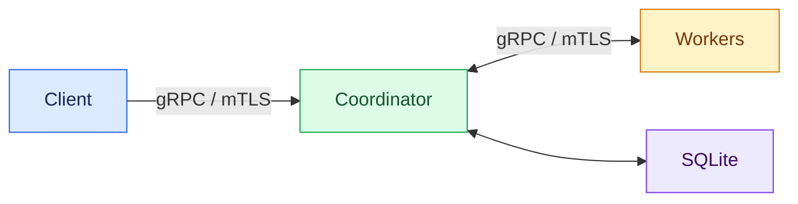

简体中文 | [English](README.en.md)

# DistributedZKRuntime

## 项目简介

DistributedZKRuntime 是一个用 Go 实现的分布式任务运行时，采用单 Coordinator、多 Worker 模型，通过 gRPC/mTLS 通信，并使用 SQLite 持久化任务状态与完整任务规格。运行时管理任务尝试、重试、lease、过期结果 fencing、取消与重启恢复。BN254 上的 MiMC 原像 Groth16 证明是其中的专用工作负载：Worker 生成证明，Coordinator 独立验证计算结果。

项目关注远端计算中的结果接受问题：请求超时、Worker 故障或 Coordinator 重启之后，系统如何区分仍然有效的结果与已经过期的尝试？下面的五个设计取舍解释了证明验证、任务身份和资源生命周期如何共同回答这个问题。

## 架构概览



`SubmitJob` 将 Job 以 `Queued` 状态持久接纳；成功时返回相同的 JobID、`Accepted` 和 `AttemptID=0`，不返回执行终态。接纳后的调度和执行由 Coordinator 后台拥有，独立于提交 RPC 的生命周期。Client 通过 `GetJob` 观察持久化状态，并在产生终态后读取结果。已接纳 Job 的重复提交仍按既有 JobID/任务规格冲突规则拒绝。

## 核心能力

- **分布式执行：** 注册、心跳与存活检测，支持 hash、sleep 和 preimage 证明任务。
- **可靠性：** AttemptID、lease、结果 fencing、故障重试、取消、SQLite 恢复和有界关闭。
- **信任与容量：** mTLS 授权、公开载荷校验、独立 Groth16 验证和 Worker 证明并发限制。
- **可观测性：** 语义化运行时指标和 Prometheus 指标端点。

## 设计取舍

### 1. Coordinator 不持有 Worker 的 secret，如何确认结果正确？

把 secret 放进提交 payload 会让 Coordinator 获得本应留在 Worker 的私密值。生产任务 `zk_preimage_prove` 因而只提交公开 digest 和 `witness_ref`，Worker 通过本地 WitnessStore 找到 secret。[ZKPreimageTask](internal/runtime/zk_preimage_task.go) 用它生成 `MiMC(secret) == digest` 的 Groth16 证明；固定依赖版本下，这个 BN254/R1CS 电路有 331 个约束。

Worker 自报 Succeeded 并不足以确认关系成立。[Coordinator](cmd/coordinator/zk_preimage_verifier.go) 使用匹配的 verifying key 和公开 digest 实际调用 Verify，无需获得 secret 或重复私密计算。这样，私密输入的持有与计算结果的检查由不同组件承担：Worker 负责生成证明，Coordinator 依据证明决定是否认可公开关系。

### 2. 有了 mTLS，为什么还要绑定 WorkerID 并检查 RPC 权限？

mTLS 能确认连接对端的身份，却不能单独决定它有权执行哪些操作。项目要求 TLS 1.3/mTLS，并通过[方法授权](internal/rpcauth/policy.go) 区分角色：Client 提交任务，Worker 注册和发送心跳，只有配置的 Coordinator 可以调用 Worker 的 ExecuteJob。连接身份与业务权限因此分别检查。

请求里的 WorkerID 仍由对端填写，注册和心跳必须将它与证书中的 Worker 身份绑定。注册还会[检查 advertised 地址与证书主机名是否匹配](cmd/coordinator/transport.go)；出站连接校验 DNS/IP SAN 和预期 URI 身份。调度时选择的逻辑 Worker，因而与实际通信的身份和端点保持对应，而不是只信任一个请求字段。

### 3. 为什么数学上正确的 Worker 结果，仍可能被拒绝？

假设 Attempt 1 的 lease 已到期，Coordinator 取消该尝试并开始 Attempt 2，旧 Worker 却仍在完成同步证明。它随后返回的证明即使正确，也不该覆盖新尝试的结果。JobID 标识任务，单调 AttemptID 区分尝试代次，lease 则限定每次尝试的有效期；证明正确性与尝试有效性是两个独立条件。

[执行路径](cmd/coordinator/execution.go) 先检查响应 JobID、AttemptID 和当前 lease，再验证证明。Verify 期间也可能发生取消或租约到期，因此 `persistTerminalResult` 在保存终态前再次检查父上下文与 lease，并在同一互斥锁下完成检查和 Save，排除本地代次在中间被替换。旧计算可能与重试重叠，但迟到的正确证明不会因此自动成为可接受结果。

### 4. Coordinator 崩溃后，如何延续任务的尝试身份？

如果 AttemptID 只在内存中，重启后从 1 开始就可能重新使用旧代次。SQLite 的 JobRecord 因而保存任务代次和完整任务规格。[分配尝试](cmd/coordinator/attempts.go) 时使用 `nextAttempt = max(inMemoryAttempt, persistedAttempt) + 1`，先保存 JobRunning 记录，再发布内存 AttemptID 和 lease，随后派发；保存失败就不会发布该次尝试。已持久化的 Attempt 7 在新进程中会继续为 Attempt 8。

启动恢复将通过任务规格校验的 Running 记录标记为 Recovering，保留代次和输入。[Coordinator](cmd/coordinator/jobs.go) 从持久化的 Queued 和 Recovering 记录中发现待执行任务，并以自己拥有的执行会话管理工作。Attempt 的发布得到持久化确认后才会派发；AttemptID 和 lease 约束授权与结果接受。条件修复和在线对账保留不确定写入的处理责任，保护已有终态和较新代次。Client 通过 `GetJob` 独立观察持久化的终态结果。

### 5. 取消 Groth16 任务后，为什么不立即释放并发名额？

Go context 取消是协作信号，当前同步 Groth16 Prove 不会因此自动停止。请求结束或 Coordinator 开始重试时，旧证明仍可能占用 CPU。如果立即释放名额，新计算就能在旧计算尚未完成时进入，连续取消会让真实并发数突破配置容量。

Worker 共享的 [ProvingLimiter](internal/runtime/proving_limiter.go) 因而将名额保留到任务真正退出，容量满时直接返回 ResourceExhausted。[ZKPreimageTask](internal/runtime/zk_preimage_task.go) 在 Prove 前检查取消，并在证明和编码完成后检查结果截止时间；迟到输出可以丢弃，尚未结束的计算却仍计入容量。Worker 关闭时也等待实际 handler 退出，使资源归还以计算完成为依据。

## 快速开始

在 **Linux/WSL** 的仓库根目录运行真实本地演示：

```sh
go run -mod=readonly ./cmd/demo
```

需要满足 [go.mod](go.mod) 中 Go **1.27.1** 要求的本地工具链、Bash、OpenSSL 3、Git 和所需 GNU 工具，并提前缓存 Go 依赖；demo 的子命令使用离线构建，不会安装工具或下载缺失依赖。

演示启动真实 Coordinator/Worker 进程，生成隔离的临时开发 PKI，通过 gRPC/mTLS 接纳固定 hash 任务，再通过 `GetJob` 观察终态，并独立核对 SHA-256 输出与 SQLite 终态。两端均使用 `-disable-zk=true`，无需 Groth16 keys 或私密 witness；成功后回收所属子进程并删除临时文件。真实 ZK 执行与证明验证另由[集成测试](cmd/coordinator/zk_preimage_integration_test.go)覆盖。

仅检查构建时，使用：

```sh
go build -mod=readonly ./...
```

构建检查不会启动演示或准备运行材料。手动以默认 ZK 模式启动服务，仍需受信任 CA 与匹配角色、端点的 mTLS 证书、身份允许列表、匹配的 Groth16 proving/verifying keys、Worker 本地 witness 数据和可写的 SQLite 路径。测试入口与环境要求见 [Go 测试工作流](scripts/README.md)。

## 范围与限制

当前运行时采用单 Coordinator、多 Worker 模型，通过 SQLite 持久化任务状态并支持重启恢复，尚不支持多 Coordinator 高可用。AttemptID 与 lease 共同约束结果接受；旧计算可能与重试重叠，因此结果 fencing 不等于恰好执行一次的保证，计算是否执行与结果是否被接受是两个不同问题。
